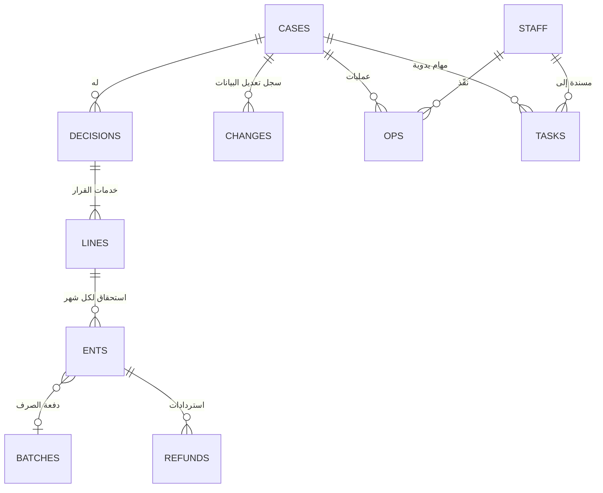

# المرحلة الثانية: تصميم قاعدة البيانات

المفاتيح: الحالة = كود الحالة (لا يتكرر). القرار = معرّف + رقم قرار لا يتكرر. البند = `decId_n`. الاستحقاق = `lineId_YYYY-MM` (يمنع تكرار استحقاق نفس الشهر).

## الجداول

### `cases` — MASTER الحالات
| الحقل | الوصف |
|---|---|
| code | كود الحالة (المفتاح، لا يتكرر) |
| name, birth, gender, nationality, familySize | البيانات الأساسية (السن يُحسب من الميلاد) |
| governorate, address | المحافظة والعنوان |
| phone, phone2 | التواصل |
| unhcr | رقم المفوضية |
| recvMethod, recvName, recvPhone, recvId, recvBranch | بيانات الاستلام والتحويل |
| dataConfirmed, confirmedAt, confirmedBy | هل أُكدت البيانات بمكالمة |
| notes | ملاحظات |
| createdAt/By, updatedAt/By | التوثيق |

### `changes` — سجل تعديل بيانات الحالة (جديد)
`code, ts, by, source (تعديل بيانات / مكالمة تأكيد بيانات), diffs[{field, label, old, new}]`

### `decisions` — القرارات
`no, code, text, donor, issueDate, status (مستمر/موقوف/مسحوب/منتهي), stopReason, stopDate, stoppedBy, renewOf, override (سبب اعتماد تعارض), renewal{status, at, by, note, newDec}`

### `lines` — خدمات القرار
`decId, code, service, amount, months, startMonth, endMonth, mismatchNote, extendedBy`

### `ents` — الاستحقاق الشهري (قلب دورة التشغيل)
| مجموعة الحقول | الحقول |
|---|---|
| التعريف | code, decId, lineId, service, kind, month, base, amount, v2 |
| التأكيد | needsConfirm, confirmedAt, confirmedBy, confirmNote, confTries, confAssignee |
| الاعتماد | holdApproved{by, at, reason, how}, carriedFrom{id, month, amount} |
| الإرسال | sent, sentAt, sentBy, batchId |
| التحويل | transfer{amount, method, date, ref, batchRef, by, at} |
| المتابعة | attempts[{at, by, answered, result, note, voided}], followResult, noAnswer, staffDone, followAt, followBy, followAssignee |
| عدم الصرف | notPaid{reason, action, note, at, by}, actionAssignee, actionDone{at, by, result} |
| التعثر / الإيقاف / التسوية | stuck{reason, at, by}, stopped{...}, settled{how, into, by, at, reason} |

**المرحلة لا تُخزّن كحقل بل تُحسب** من هذه الحقول في كل عرض (`stageOf`)، فلا يمكن أن تتناقض مع البيانات.

### `batches` — دفعات الصرف (جديد)
`month, kind, count, total, by, createdAt, entIds[]`

### `refunds` — الاستردادات (جديد)
`entId, code, month, service, transferAmount, amount, date, reason, ref, type (كلي/جزئي — يُحسب), settlement (معلقة/تمت التسوية), how (سياسة التعويض), by, createdAt`

### `ops` — سجل العمليات الموحد
`type, team, weight, scope, code, dept, date (تاريخ التنفيذ), status, result, notes, attach, count, ref, auto, by (المنفذ — تلقائي), createdAt (وقت التسجيل — تلقائي), returned, returnNote`

### `tasks` — المهام اليدوية (جديد)
`title, type, code, assignee, status (جديدة/قيد التنفيذ/مكتملة/متعثرة), createdAt, createdBy, due, startedAt, completedAt, completedBy, result, returned, returnNote`

> مهام التشغيل المتكررة (تأكيد البيانات، متابعة الصرف، معالجة عدم الصرف) **لا تُنشأ كسجلات منفصلة**؛ تُشتق من الاستحقاق نفسه. هذا يمنع أن تكون المهمة «مكتملة» والاستحقاق غير مكتمل أو العكس، ويقلل الكتابة على قاعدة البيانات.

### `staff` — المستخدمون والصلاحيات (جديد)
`id, role (مدير/مشرف/مالي/موظف/قراءة), team, active, joinedAt`

### `config/main` — الإعدادات (جديد)
`renewLead, confirmDays, followDays, actionDays, taskDays, policy, assign{confirm, follow, action}, services[{name, kind, cycle, follow}]`

### `audit` — سجل التدقيق
`ts, by, action, target, detail, old, new`
