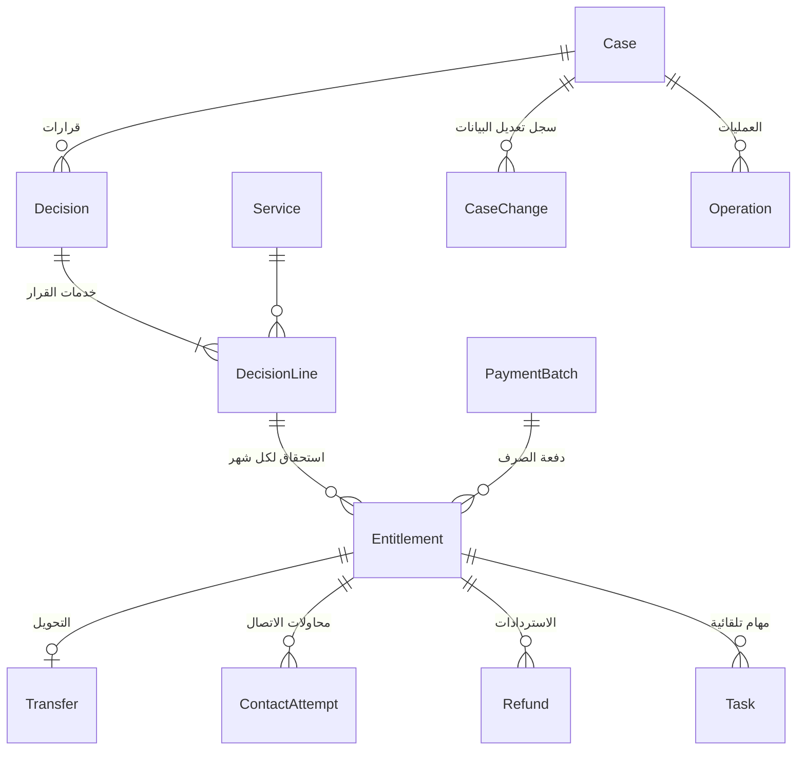

# المرحلة الثانية: تصميم قاعدة البيانات

المصدر الرسمي للتصميم: [`prisma/schema.prisma`](../prisma/schema.prisma) — PostgreSQL، schema اسمها `social`.

| الجدول | الدور | مفاتيح وقيود |
|---|---|---|
| `Case` | MASTER الحالات: البيانات الأساسية + التواصل + الاستلام والتحويل + رقم المفوضية + هل البيانات مؤكدة | كود الحالة مفتاح أساسي (لا يتكرر) |
| `CaseChange` | كل تعديل: الحقل، القيمة القديمة، الجديدة، مين، إمتى، المصدر | لا تعديل ولا حذف (trigger) |
| `Service` | أنواع الخدمات: الفئة (مالي/كارت/عيني/خدمة)، الدورة (شهري/مرة/تغطية)، هل تحتاج متابعة | الاسم لا يتكرر ولا يتغير |
| `Decision` | القرار: رقم، تاريخ، حالة (مستمر/موقوف/مسحوب/منتهي)، سبب الإيقاف، موقف التجديد، اعتماد التعارض | رقم القرار لا يتكرر |
| `DecisionLine` | خدمة داخل القرار: القيمة، المدة، من شهر، إلى شهر، ملاحظة اختلاف المدة، التمديد | البداية ≤ النهاية، المدة ≥ 1 |
| `Entitlement` | الاستحقاق الشهري: التأكيد، اعتماد الإدراج، الإرسال، نتيجة المتابعة، سبب عدم الصرف، التعثر، الإيقاف، التسوية، الترحيل | (خدمة + شهر) لا يتكرر · المبالغ ≥ 0 |
| `PaymentBatch` | دفعة الصرف: كود، شهر، فئة، عدد، إجمالي، مين أرسلها | |
| `Transfer` | التحويل: المبلغ، الطريقة، التاريخ، المرجع | واحد لكل استحقاق · المبلغ > 0 · لا حذف |
| `ContactAttempt` | كل مكالمة تأكيد أو متابعة بنتيجتها ومين ووقتها | لا حذف · «أُرجعت للتصحيح» بدل الحذف |
| `Refund` | الاسترداد: المحوّل، المسترد، النوع (كلي/جزئي)، السبب، المرجع، التسوية وطريقتها | المسترد ≤ المحوّل · لا حذف |
| `Task` | المهام: تأكيد / متابعة / معالجة (تلقائية) + يدوية · المسند إليه، المنفذ فعلاً، الموعد، النتيجة، الإرجاع | مهمة تلقائية واحدة لكل (نوع + استحقاق) |
| `OpType` / `Operation` | كتالوج العمليات بأوزانها، وسجل كل عملية بالمنفذ ووقت التسجيل وتاريخ التنفيذ | |
| `User` | المستخدمون والأدوار والفرق | الإيميل لا يتكرر |
| `Setting` | قواعد التشغيل والإسناد التلقائي وسياسة الشهر غير المستلم | |
| `AuditLog` | سجل التدقيق | لا تعديل ولا حذف (trigger) |
| `SsoJti` | تذاكر الدخول من البوابة المستخدمة | تمنع استخدام التذكرة مرتين |

**مرحلة الاستحقاق لا تُخزّن** — تُحسب من الحقول في كل عرض (`src/lib/stage.ts`، عليها اختبارات وحدة)، فلا يمكن أن تتناقض مع البيانات.
