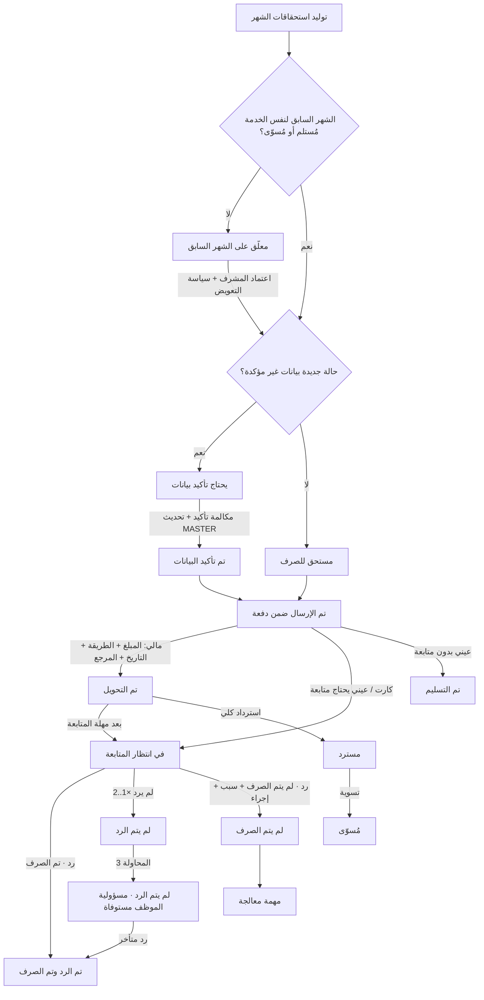

# دورات العمل والقواعد

## 1. دورة الاستحقاق الشهري

### القواعد المطبقة في النظام

| القاعدة | التطبيق |
|---|---|
| لا يُنشأ استحقاق بعد نهاية القرار | التوليد يفحص `startMonth ≤ الشهر ≤ endMonth` |
| لا يتكرر استحقاق الشهر | المفتاح `lineId_month` |
| الحالة الجديدة لا تُرسل قبل تأكيد البيانات | زر الإرسال يتخطاها ويوضح السبب |
| التأكيد يتطلب هاتفاً، وللمالي طريقة استلام، وللمحفظة رقمها | يُرفض الحفظ بدونها |
| التحويل لا يكتمل بدون المبلغ والطريقة والتاريخ والمرجع | يُرفض الحفظ، ويُمنع تكرار المرجع لحالة أخرى |
| التحويل ≠ الاستلام | بعد التحويل تبقى الحالة في المتابعة حتى تسجيل النتيجة |
| كل محاولة اتصال تُسجل بتاريخها والموظف | `attempts[]` |
| 3 محاولات بدون رد | مسؤولية الموظف مستوفاة، والاستلام يبقى غير مكتمل (`noAnswer`) |
| الشهر التالي لا يُدرج تلقائياً | يُعلّق حتى يُستلم الشهر السابق أو يعتمده المشرف |
| عدم الصرف | السبب والإجراء إلزاميان، وتُنشأ مهمة معالجة |
| انتهاء المدة | القرار يظهر «منتهي» تلقائياً، ويظهر في قائمة الإغلاق |

## 2. سياسة الشهر غير المستلم (قابلة للضبط)

عند اعتماد إدراج استحقاق معلّق أو تسوية استرداد يختار المشرف (والافتراضي من الإعدادات):

- **ترحيل**: يُضاف المبلغ غير المستلم على استحقاق الشهر الجديد (سلوك v1).
- **تمديد**: يُمد البند شهراً بدل الشهر غير المستلم.
- **لا تعويض**: يسقط الشهر.

في كل الحالات يُعلَّم الشهر السابق «مُسوّى» فلا يُعوَّض مرتين.

## 3. الاسترداد

- يرتبط بالاستحقاق وبمرجع التحويل الأصلي.
- كلي أو جزئي يُحدد تلقائياً، ولا يتجاوز المتبقي من التحويل.
- صافي المصروف = المحوّل − المسترد، و«وصل للمستفيد» لا يشمل المسترد.
- الاسترداد الكلي يجعل الاستحقاق «مسترد» حتى التسوية.

## 4. التجديد والانتهاء

- **تنتهي خلال شهرين** (قابل للضبط): كل قرار مستمر آخر شهر فيه خلال الفترة. يمكن إرسالها للتجديد جماعياً (تُسجل عملية «إرسال للمناقشة أو البحث» باسم الموظف) أو نسخ القائمة.
- **أُرسلت للتجديد**: حتى يُسجل قرار التجديد (يُربط تلقائياً بالقرار القديم ويصبح «تم التجديد») أو «لم يُجدد».
- **انتهت وتنتظر الإغلاق**: إغلاقها كـ«منتهي» يوقف أي استحقاق لم يُرسل.

## 5. المهام والإنتاجية

| المهمة | تُنشأ عند | تكتمل عند | الموعد |
|---|---|---|---|
| مكالمة تأكيد بيانات | توليد استحقاق لحالة جديدة | تسجيل نتيجة التأكيد | + مهلة التأكيد |
| مكالمة متابعة صرف | التحويل (مالي) أو الإرسال (كارت/عيني بمتابعة) | الرد أو 3 محاولات | + مهلة المتابعة |
| معالجة عدم صرف | تسجيل «لم يتم الصرف» | تسجيل ما تم تنفيذه | + مهلة المعالجة |
| يدوية | يُنشئها أي موظف | نتيجة إلزامية | يحددها المنشئ |

- **مسندة إلى** من يجب أن ينفذ، و**نفّذها** من نفذ فعلاً. التقارير تعرض الاثنين.
- المتأخرة = لم تكتمل وتجاوزت موعدها، أو اكتملت بعد موعدها.
- الإرجاع للتصحيح (مشرف) يعيد المهمة أو العملية ويُحسب على من نفذها.
- متوسط زمن التنفيذ = من إنشاء المهمة حتى إكمالها، لمن أكملها.
- الإنتاجية بالأوزان = مجموع (وزن العملية × عدد المرات) من سجل العمليات الفعلي.
